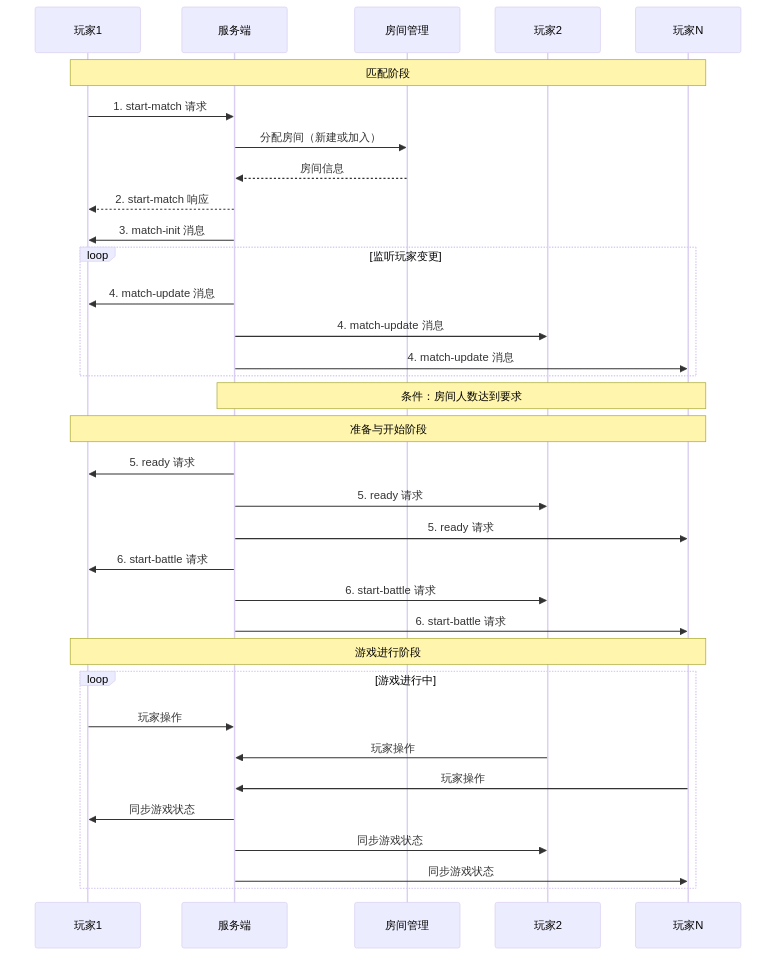

* 依赖安装
1. 需要配置 java 环境
2. 下载 build-tools.zip 并解压到当前目录下。确保目录结构如下：
   + project root
     + build-tools
       + android-build-tools
       + rz
       + apktool.jar
       + mcs.exe
     + Solarmax3vt3_killer
     + ...

* 打包 apk
进入 scripts 目录，点击 repack-apk.bat，会弹出一个命令行窗口，无需操作任何操作，等待它执行结束消失即可

此时项目根目录中会出现 build 文件夹，其中 Solarmax3vt3_killersigned-aligned.apk 就是打包的apk

* 联机
** start match request params
|            | type      | misc_id | map_id | cType      | nPlayerNum | bQuick | chapterId | nDifficult | GroupID | bEnterWatch |
| default    |           | ""      | ""     |            |            | false  | ""        | -1         | ""      | false       |
|------------+-----------+---------+--------+------------+------------+--------+-----------+------------+---------+-------------|
| 4人混战     | mt_ladder |         |        | ct_1v1v1v1 |          4 | true   |           |            |         |             |
| 3人混战     | mt_ladder |         |        | ct_1v1v1   |          3 | true   |           |            |         |             |
| 2人切磋     | mt_ladder |         |        | ct_1v1     |          2 | true   |           |            |         |             |
| 2v2组队     | mt_ladder |         |        | ct_2v2     |          4 | false  |           |            |         |             |
| 2v2匹配     | mt_ladder |         |        | ct_2v2     |          4 | true   |           |            |         |             |
|------------+-----------+---------+--------+------------+------------+--------+-----------+------------+---------+-------------|
| 2人合作组队  | mt_room   |         | ✓      | ct_2vPC    |          2 | false  | ✓         | ✓          | ✓       |             |
| 3人合作组队  | mt_room   |         | ✓      | ct_3vPC    |          3 | false  | ✓         | ✓          | ✓       |             |
| 4人合作组队  | mt_room   |         | ✓      | ct_4vPC    |          4 | false  | ✓         | ✓          | ✓       |             |
| 2人合作匹配  | mt_room   |         | ✓      | ct_2vPC    |          2 | true   | ✓         | ✓          | ✓       |             |
| 3人合作匹配  | mt_room   |         | ✓      | ct_3vPC    |          3 | true   | ✓         | ✓          | ✓       |             |
| 4人合作匹配  | mt_room   |         | ✓      | ct_4vPC    |          4 | true   | ✓         | ✓          | ✓       |             |
|------------+-----------+---------+--------+------------+------------+--------+-----------+------------+---------+-------------|
| 4人混战     | mt_room   |         |        | ct_1v1v1v1 |          4 | false  |           |            |         |             |
| 3人混战     | mt_room   |         |        | ct_1v1v1   |          3 | false  |           |            |         |             |
| 2人切磋     | mt_room   |         |        | ct_1v1     |          2 | false  |           |            |         |             |
| 2v2        | mt_room   |         |        | ct_2v2     |          4 | false  |           |            |         |             |
|------------+-----------+---------+--------+------------+------------+--------+-----------+------------+---------+-------------|
| 假如房间观战 | mt_room   | room_id |        | ct_null    |          0 | false  |           |            |         | true        |
| 加入房间对战 | mt_room   | room_id |        | ct_null    |          0 | false  |           |            |         |             |

1. 创建房间中还有一个 ct_null 暂不确认场景，应该是没有入口的
2. 被邀请时，客户端不发出 start-match 请求，服务端主动推送

** start match
#+begin_src mermaid :file "images/output.png"
  sequenceDiagram
      participant U1 as 玩家1
      participant S as 服务端
      participant RM as 房间管理
      participant U2 as 玩家2
      participant U3 as 玩家N

      Note over U1, U3: 匹配阶段

      U1 ->> S: 1. start-match 请求
      S ->> RM: 分配房间（新建或加入）
      RM -->> S: 房间信息
      S -->> U1: 2. start-match 响应
      S ->> U1: 3. match-init 消息

      loop 监听玩家变更
          S ->> U1: 4. match-update 消息
          S ->> U2: 4. match-update 消息
          S ->> U3: 4. match-update 消息
      end

      Note over S, U3: 条件：房间人数达到要求

      Note over U1, U3: 准备与开始阶段

      S ->> U1: 5. ready 请求
      S ->> U2: 5. ready 请求
      S ->> U3: 5. ready 请求

      S ->> U1: 6. start-battle 请求
      S ->> U2: 6. start-battle 请求
      S ->> U3: 6. start-battle 请求

      Note over U1, U3: 游戏进行阶段

      loop 游戏进行中
          U1 ->> S: 玩家操作
          U2 ->> S: 玩家操作
          U3 ->> S: 玩家操作
          S ->> U1: 同步游戏状态
          S ->> U2: 同步游戏状态
          S ->> U3: 同步游戏状态
      end
#+end_src

#+RESULTS:

